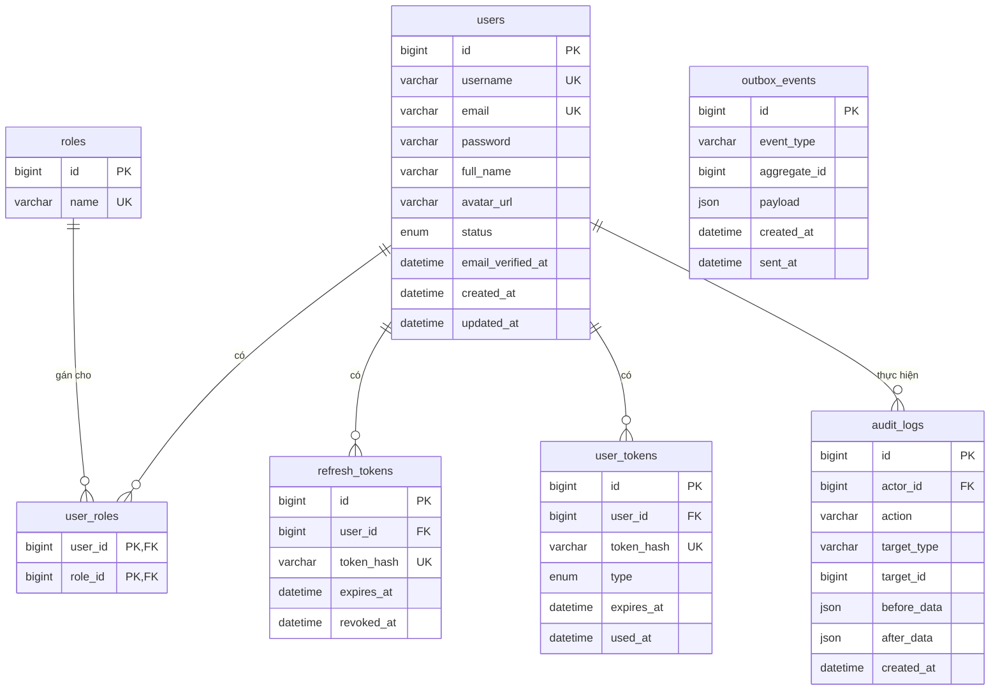
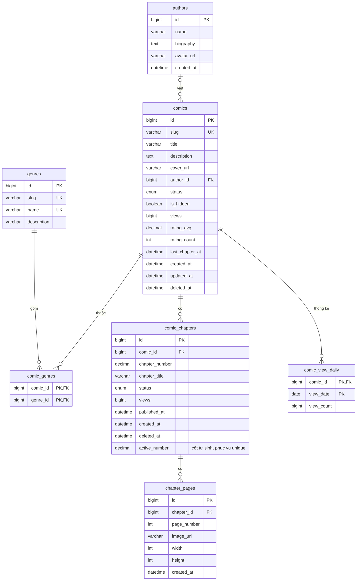
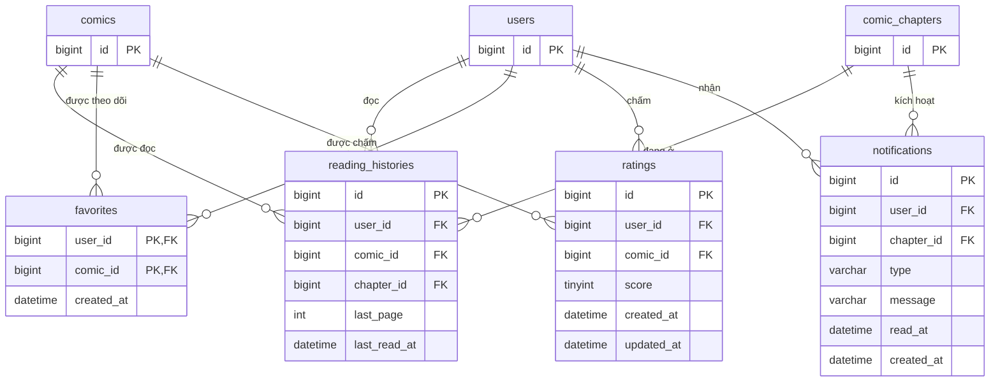
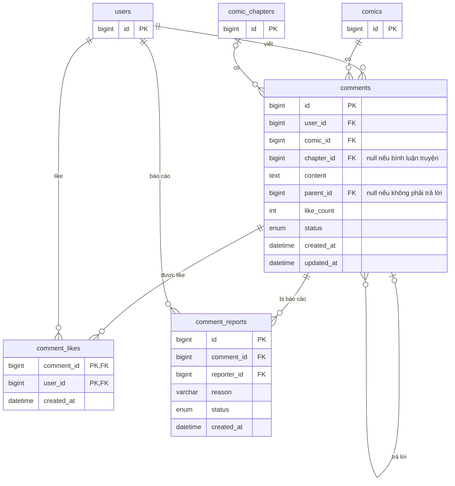

# Tổng hợp toàn bộ API Dự án Truyện

Stack: Java + Spring Boot (backend), React thuần + Vite (frontend), MySQL, Redis, MinIO/S3, RabbitMQ.


## 1. Danh sách API

### 1.1. Tổng quan

| Module            | API       | Ghi chú                                                                 |
| ----------------- | --------: | ----------------------------------------------------------------------- |
| Authentication    |         8 | register, login, refresh, logout, forgot/reset password, verify/gửi lại email |
| User / Profile    |         4 | xem, sửa profile, đổi mật khẩu, đổi avatar                              |
| Comic (Truyện)    |         4 | list + search + lọc, chi tiết, hot, trạng thái cá nhân                  |
| Genre (Thể loại)  |         2 | list, chi tiết                                                          |
| Author (Tác giả)  |         2 | list, chi tiết                                                          |
| Chapter           |         3 | danh sách chapter, đọc chapter (ảnh + next/prev), ghi nhận view         |
| Reading History   |         3 | lưu tiến độ, xem lịch sử, xóa                                           |
| Follow / Bookmark |         3 | theo dõi, bỏ theo dõi, danh sách theo dõi                               |
| Comment           |         6 | list, tạo, xóa, like, bỏ like, báo cáo                                  |
| Rating            |         2 | chấm điểm, xem điểm                                                     |
| Notification      |         4 | list, số chưa đọc, đánh dấu đã đọc, đọc tất cả                          |
| Admin Comic       |         6 | list, tạo, sửa, xóa, ẩn/hiện, đổi ảnh bìa                               |
| Admin Chapter     |         7 | list, tạo nháp, sửa, xóa, upload trang, sắp xếp trang, publish          |
| Admin Genre       |         3 | tạo, sửa, xóa                                                           |
| Admin Author      |         3 | tạo, sửa, xóa                                                           |
| Admin User        |         3 | list, khóa/mở khóa, đổi role                                            |
| Admin Comment     |         3 | list bị báo cáo, xử lý báo cáo, xóa                                     |
| Dashboard         |         5 | tổng quan, top truyện, lượt xem theo ngày, user mới, top thể loại       |
| Audit Log         |         2 | list, chi tiết                                                          |
| **Tổng**          |  **73**   |                                                                         |

### 1.2. Chi tiết endpoint

Tiền tố chung: `/api/v1`. Quyền: Public = không cần đăng nhập, User = đã đăng nhập, Admin = ROLE_ADMIN.

**Authentication**

| Method | Endpoint                  | Quyền  | Ghi chú                                  |
| ------ | ------------------------- | ------ | ---------------------------------------- |
| POST   | /auth/register            | Public |                                          |
| POST   | /auth/login               | Public | Có rate limit                            |
| POST   | /auth/refresh             | Public | Đọc refresh token từ cookie, cấp token mới |
| POST   | /auth/logout              | User   | Thu hồi refresh token                    |
| POST   | /auth/forgot-password     | Public | Luôn trả 200 dù email có tồn tại hay không |
| POST   | /auth/reset-password      | Public |                                          |
| POST   | /auth/verify-email        | Public |                                          |
| POST   | /auth/resend-verification | Public | Có rate limit                            |

**User / Profile**

| Method | Endpoint           | Quyền | Ghi chú |
| ------ | ------------------ | ----- | ------- |
| GET    | /users/me          | User  |         |
| PATCH  | /users/me          | User  |         |
| PUT    | /users/me/password | User  | Thu hồi các refresh token khác |
| PUT    | /users/me/avatar   | User  | multipart |

**Comic**

| Method | Endpoint           | Quyền  | Ghi chú |
| ------ | ------------------ | ------ | ------- |
| GET    | /comics            | Public | `?keyword=&genre=&status=&authorId=&sort=latest,views,rating&page=&size=` (gộp list, search, mới cập nhật, theo thể loại) |
| GET    | /comics/{slug}     | Public | Được cache nên không chứa dữ liệu riêng của user |
| GET    | /comics/hot        | Public | `?period=day,week,month` |
| GET    | /comics/{id}/me    | User   | isFollowing, myRating, chapter đang đọc dở |

**Author**

| Method | Endpoint      | Quyền  | Ghi chú |
| ------ | ------------- | ------ | ------- |
| GET    | /authors      | Public |         |
| GET    | /authors/{id} | Public |         |

**Genre**

| Method | Endpoint       | Quyền  | Ghi chú |
| ------ | -------------- | ------ | ------- |
| GET    | /genres        | Public |         |
| GET    | /genres/{slug} | Public |         |

**Chapter**

| Method | Endpoint                         | Quyền  | Ghi chú |
| ------ | -------------------------------- | ------ | ------- |
| GET    | /comics/{slug}/chapters          | Public | Chỉ chapter đã publish |
| GET    | /comics/{slug}/chapters/{number} | Public | Trả list ảnh + prevChapter, nextChapter |
| POST   | /chapters/{id}/views             | Public | Tách khỏi GET để cache được và chống đếm trùng |

**Reading History**

| Method | Endpoint             | Quyền | Ghi chú |
| ------ | -------------------- | ----- | ------- |
| PUT    | /me/history/{comicId} | User | Upsert chapter + trang, frontend debounce khi gọi |
| GET    | /me/history          | User  | Phân trang |
| DELETE | /me/history/{comicId} | User |         |

**Follow / Bookmark**

| Method | Endpoint            | Quyền | Ghi chú |
| ------ | ------------------- | ----- | ------- |
| POST   | /comics/{id}/follow | User  | Idempotent |
| DELETE | /comics/{id}/follow | User  | Idempotent |
| GET    | /me/follows         | User  | Phân trang |

**Comment**

| Method | Endpoint              | Quyền  | Ghi chú |
| ------ | --------------------- | ------ | ------- |
| GET    | /comics/{id}/comments | Public | `?chapterId=&page=` |
| POST   | /comics/{id}/comments | User   | Cần đã xác thực email. Body có `chapterId`, `parentId` (trả lời) tùy chọn |
| DELETE | /comments/{id}        | User   | Chỉ chủ comment |
| PUT    | /comments/{id}/like   | User   | Idempotent |
| DELETE | /comments/{id}/like   | User   | Idempotent |
| POST   | /comments/{id}/reports | User  | Mỗi user báo cáo 1 lần |

**Rating**

| Method | Endpoint            | Quyền  | Ghi chú |
| ------ | ------------------- | ------ | ------- |
| PUT    | /comics/{id}/rating | User   | Upsert, thang điểm 1–5, 1 user 1 điểm cho mỗi truyện |
| GET    | /comics/{id}/rating | Public | Điểm trung bình + số lượt |

**Notification**

| Method | Endpoint                     | Quyền | Ghi chú |
| ------ | ---------------------------- | ----- | ------- |
| GET    | /me/notifications            | User  | Phân trang |
| GET    | /me/notifications/unread-count | User | Badge chuông, polling 60s (SSE để sau) |
| PATCH  | /me/notifications/{id}/read  | User  |         |
| PATCH  | /me/notifications/read-all   | User  |         |

**Admin Comic**

| Method | Endpoint                     | Quyền | Ghi chú |
| ------ | ---------------------------- | ----- | ------- |
| GET    | /admin/comics                | Admin | Gồm cả truyện đang ẩn |
| POST   | /admin/comics                | Admin |         |
| PUT    | /admin/comics/{id}           | Admin |         |
| DELETE | /admin/comics/{id}           | Admin | Soft delete |
| PATCH  | /admin/comics/{id}/visibility | Admin | Ẩn/hiện |
| PUT    | /admin/comics/{id}/cover     | Admin | multipart |

**Admin Chapter**

| Method | Endpoint                       | Quyền | Ghi chú |
| ------ | ------------------------------ | ----- | ------- |
| GET    | /admin/comics/{id}/chapters    | Admin | Gồm cả bản nháp |
| POST   | /admin/comics/{id}/chapters    | Admin | Tạo ở trạng thái DRAFT |
| PUT    | /admin/chapters/{id}           | Admin |         |
| DELETE | /admin/chapters/{id}           | Admin | Soft delete |
| POST   | /admin/chapters/{id}/pages     | Admin | multipart, nhiều ảnh |
| PUT    | /admin/chapters/{id}/pages     | Admin | Sắp xếp lại / bỏ trang |
| POST   | /admin/chapters/{id}/publish   | Admin | Kiểm tra có ít nhất 1 trang, phát event |

**Admin Author**

| Method | Endpoint            | Quyền | Ghi chú |
| ------ | ------------------- | ----- | ------- |
| POST   | /admin/authors      | Admin |         |
| PUT    | /admin/authors/{id} | Admin |         |
| DELETE | /admin/authors/{id} | Admin | Chặn xóa nếu còn truyện gắn với tác giả |

**Admin Genre**

| Method | Endpoint           | Quyền | Ghi chú |
| ------ | ------------------ | ----- | ------- |
| POST   | /admin/genres      | Admin |         |
| PUT    | /admin/genres/{id} | Admin |         |
| DELETE | /admin/genres/{id} | Admin | Chặn xóa nếu còn truyện gắn với thể loại |

**Admin User**

| Method | Endpoint                | Quyền | Ghi chú |
| ------ | ----------------------- | ----- | ------- |
| GET    | /admin/users            | Admin |         |
| PATCH  | /admin/users/{id}/status | Admin | Khi khóa: thu hồi toàn bộ refresh token |
| PATCH  | /admin/users/{id}/role  | Admin | Không cho tự hạ quyền chính mình |

**Admin Comment**

| Method | Endpoint                   | Quyền | Ghi chú |
| ------ | -------------------------- | ----- | ------- |
| GET    | /admin/comments/reports    | Admin |         |
| PATCH  | /admin/comments/reports/{id} | Admin | Bỏ qua / đã xử lý |
| DELETE | /admin/comments/{id}       | Admin | Soft delete |

**Dashboard**

| Method | Endpoint                   | Quyền | Ghi chú |
| ------ | -------------------------- | ----- | ------- |
| GET    | /admin/dashboard/summary   | Admin |         |
| GET    | /admin/dashboard/top-comics | Admin | `?from=&to=&limit=` |
| GET    | /admin/dashboard/views     | Admin | `?from=&to=`, đọc từ bảng thống kê ngày |
| GET    | /admin/dashboard/new-users | Admin | `?from=&to=` |
| GET    | /admin/dashboard/top-genres | Admin | `?from=&to=&limit=` |

**Audit Log**

| Method | Endpoint             | Quyền | Ghi chú |
| ------ | -------------------- | ----- | ------- |
| GET    | /admin/audit-logs    | Admin | `?actor=&action=&from=&to=` |
| GET    | /admin/audit-logs/{id} | Admin |       |


## 2. Kiến trúc

```
 ┌──────────────┐    tải ảnh trực tiếp     ┌───────────────┐
 │    React     │ ───────────────────────► │ CDN (nếu có)  │
 └──────┬───────┘                          └───────┬───────┘
        │ REST + JWT                               │
        ▼                                          │
┌──────────────────────────────────────────┐       │
│      Spring Boot (modular monolith)      │       │
│                                          │       │
│  auth · user · comic · chapter · history │       │
│  social · notification · admin · audit   │       │
└───┬──────────┬──────────┬───────────┬────┘       │
    │          │          │           │            │
    ▼          ▼          ▼           ▼            │
  MySQL      Redis     RabbitMQ   MinIO / S3 ◄─────┘
```

- MySQL: dữ liệu chính, chạy MySQL80 trên máy và quản lý bằng MySQL Workbench. Redis, RabbitMQ, MinIO, Mailpit chạy bằng Docker khi dev.
- Redis: cache trang chủ/chi tiết, đếm view, bảng xếp hạng hot, rate limit.
- MinIO/S3: ảnh bìa, ảnh chapter, avatar. DB chỉ lưu object key, URL được ghép lúc trả về để sau này đổi CDN không phải sửa dữ liệu.
- RabbitMQ: event `chapter.published`, consumer nằm trong module notification.
- Ảnh không đi qua Spring Boot khi đọc truyện, tránh nghẽn server.
- Dùng một ứng dụng duy nhất, chia package theo lớp: `controller`, `service`, `repository`, `model`, `dto`, `mapper`, `event`, `config`, `security`, `exception`, `util`. Chưa cần microservice.

### Cơ sở dữ liệu

Database `comic_web` trên MySQL 8.0, gồm 21 bảng. Tạo bằng file trong thư mục `database/`: chạy `01_schema.sql` rồi `02_seed.sql` trong MySQL Workbench.

Các cột `avatar_url`, `cover_url`, `image_url` nhận object key trên MinIO/S3 (ảnh upload) hoặc URL đầy đủ (ảnh ở nơi khác, như dữ liệu mẫu). Thời gian lưu theo UTC.

**Cụm 1: Tài khoản và hệ thống**



**Cụm 2: Nội dung truyện**



**Cụm 3: Đọc, theo dõi, chấm điểm, thông báo**



**Cụm 4: Bình luận**



**Ràng buộc unique chưa hiện trên sơ đồ**

- `comic_chapters (comic_id, active_number)`: không trùng số chapter trong một truyện; chapter đã xóa mềm không tính.
- `chapter_pages (chapter_id, page_number)`: không trùng số trang.
- `reading_histories (user_id, comic_id)`: mỗi user một dòng cho mỗi truyện.
- `ratings (user_id, comic_id)`: mỗi user chấm một lần cho mỗi truyện.
- `comment_reports (comment_id, reporter_id)`: mỗi user chỉ báo cáo một comment một lần.
- `notifications (user_id, chapter_id, type)`: consumer chạy lại không tạo trùng thông báo.

### Bảo mật

- Access token sống ngắn (15 phút), frontend giữ trong bộ nhớ.
- Refresh token để trong cookie HttpOnly + Secure + SameSite, xoay vòng mỗi lần refresh.
- Rate limit cho login, forgot-password, resend-verification, tạo comment.
- Upload: kiểm tra định dạng thật của file (không tin đuôi file), giới hạn dung lượng, tự sinh tên file.
- Comment hiển thị dạng text thuần để tránh XSS.

### Frontend

React thuần chạy dạng SPA (render ở trình duyệt), build bằng Vite.

- Thư viện: React Router (điều hướng), TanStack Query (gọi API + cache), Axios (interceptor tự refresh token).
- Khi dev: dùng proxy của Vite trỏ `/api` về Spring Boot để cookie refresh token hoạt động mà không vướng CORS.
- Khi deploy: phục vụ frontend và API cùng domain, cấu hình mọi đường dẫn không phải file tĩnh trả về `index.html` để F5 không bị 404.
- Hạn chế SEO của SPA: đặt title/description cho từng trang bằng thẻ `<title>`, `<meta>` của React, làm thêm sitemap.xml. Nếu sau này cần SEO mạnh hơn thì thêm prerender cho trang truyện.


## 3. Nghiệp vụ

### 3.1. Luồng độc giả

Đọc truyện không cần đăng nhập. JWT chỉ cần cho các bước đánh dấu (User).

```
Danh sách truyện (Redis cache: hot, mới cập nhật)
 ↓
Chi tiết truyện
 ↓
Chọn chapter
 ↓
Load ảnh từ MinIO/S3 (qua CDN nếu có, lazy load)
 ↓
Tăng view: POST /chapters/{id}/views
   Redis SET NX theo (chapter + user/IP) để chống đếm trùng, TTL 1 giờ
   Redis INCR + ZINCRBY (bảng xếp hạng hot)
   Job 5 phút gom ghi xuống comics.view_count và comic_view_daily
 ↓
Lưu tiến độ (chapter + trang đang đọc)
   Khách: localStorage
   (User): PUT /me/history/{comicId}, debounce vài giây
 ↓
(User) Follow / Comment / Rating
```

### 3.2. Luồng admin đăng chapter mới

```
JWT (ROLE_ADMIN)
 ↓
Tạo / chọn truyện
 ↓
Tạo chapter ở trạng thái DRAFT
 ↓
Upload ảnh lên MinIO/S3 (nằm ngoài transaction DB)
 ↓
@Transactional lưu Pages
 ↓
Xem trước, sắp xếp lại trang nếu cần
 ↓
Publish, trong cùng một @Transactional:
   chapter.status = PUBLISHED
   comic.last_chapter_at = now
   ghi outbox_events ("chapter.published")
 ↓
Job đọc outbox, gửi sang RabbitMQ
 ↓
Consumer tạo Notification theo lô cho người follow truyện
   (idempotent nhờ unique key, lỗi thì retry rồi vào DLQ)
 ↓
Xóa cache trang chủ + chi tiết truyện
```

- Audit Log ghi cho mọi thao tác ghi của admin, không riêng bước publish. Service gọi `AuditService.record` trong cùng transaction để lưu được dữ liệu trước/sau và thao tác lỗi thì không có log.
- Job dọn ảnh mồ côi: file trên MinIO/S3 không có Page tương ứng do upload lỗi giữa chừng hoặc chapter nháp bị xóa.


## 4. Thứ tự code đề xuất

Làm theo từng module trọn vẹn (entity → repository → DTO → service → controller → test), không làm hết Entity rồi mới làm Repository. Unit test viết cùng lúc với từng module.

### Giai đoạn 0: Nền tảng

01. GitHub repo + .gitignore + README khung
02. Tạo Spring Boot project
03. MySQL Workbench: tạo database `comic_web`; docker-compose: Redis, RabbitMQ, MinIO, Mailpit (bắt mail khi dev)
04. application.yml (profile dev/prod)
05. Global Exception + format lỗi chung + Swagger

### Giai đoạn 1: Tài khoản

06. User/Register
07. Login + JWT + refresh token (+ phân quyền USER / ADMIN)
08. Gửi mail: verify email, forgot/reset password
09. Profile + đổi mật khẩu

### Giai đoạn 2: Đọc truyện (MVP)

10. Author + Genre (public + admin)
11. Comic (list, detail, search, phân trang + admin)
12. Upload ảnh (StorageService + MinIO)
13. Chapter + Pages + luồng DRAFT → publish
14. Frontend: khung dự án React + Vite, trang chủ, chi tiết truyện, trang đọc, đăng nhập/đăng ký

Hết giai đoạn này đã có sản phẩm chạy được từ đầu đến cuối.

### Giai đoạn 3: Tương tác

15. Reading History
16. Follow / Bookmark
17. Comment + báo cáo + Rating
18. Frontend: lịch sử, theo dõi, bình luận, chấm điểm

### Giai đoạn 4: Hiệu năng và thông báo

19. Redis (cache trang chủ, đếm view, hot, rate limit)
20. Notification + Outbox
21. RabbitMQ (event chapter.published)
22. Frontend: chuông thông báo

### Giai đoạn 5: Quản trị

23. Admin User + Admin Comment
24. Audit Log
25. Dashboard
26. Frontend: trang admin

### Giai đoạn 6: Hoàn thiện

27. Integration Test các luồng chính (Testcontainers)
28. CI với GitHub Actions
29. Dockerfile + deploy
30. Hoàn thiện README
